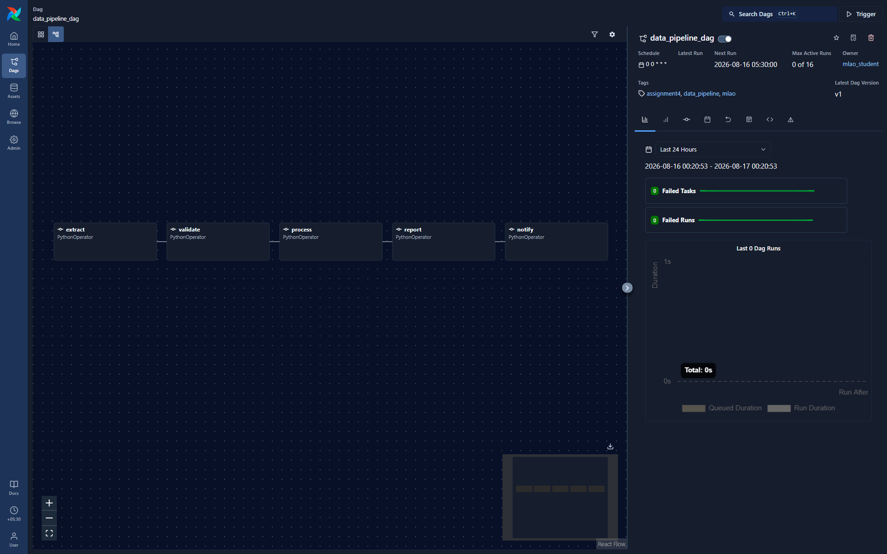
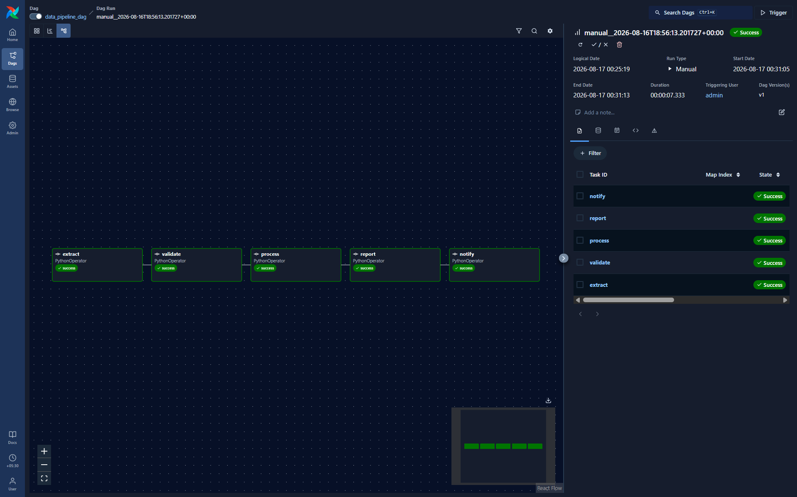

# 🔄 Workflow Automation Using Apache Airflow

> **MLOps · Assignment No. 4**


An Apache Airflow-based workflow automation pipeline that demonstrates task orchestration through a five-stage sequential DAG — covering data extraction, validation, processing, report generation, and completion notification.

---

## 📋 Table of Contents

- [Overview](#-overview)
- [Objectives](#-objectives)
- [Workflow Architecture](#-workflow-architecture)
- [Project Structure](#-project-structure)
- [Technologies Used](#-technologies-used)
- [Dataset](#-dataset)
- [Airflow DAG](#-airflow-dag)
- [Task Details](#-task-details)
- [Data Processing Results](#-data-processing-results)
- [Installation and Setup](#-installation-and-setup)
- [How to Run](#-how-to-run)
- [Generated Outputs](#-generated-outputs)
- [Screenshots](#-screenshots)
- [Conclusion](#-conclusion)

---

## 🔍 Overview

This project implements a complete **workflow automation pipeline** using [Apache Airflow](https://airflow.apache.org/), demonstrating how real-world data pipelines can be orchestrated, scheduled, and monitored through a Directed Acyclic Graph (DAG).

The pipeline processes a small employee dataset through five sequential, dependent tasks:

```
extract  ──►  validate  ──►  process  ──►  report  ──►  notify
```

Each task only executes after its predecessor completes successfully. If any task fails, all downstream tasks are automatically skipped, ensuring pipeline integrity.

**Why Apache Airflow?**  
Airflow allows workflows to be defined entirely in Python, making them version-controllable, testable, and observable through a built-in Web UI. It handles scheduling, retries, dependency management, and logging out of the box — making it the industry standard for MLOps pipeline orchestration.

---

## 🎯 Objectives

- Understand and implement **Directed Acyclic Graphs (DAGs)** in Apache Airflow
- Install and configure Apache Airflow in a **WSL2/Ubuntu** environment
- Create a **daily-scheduled, Python-driven workflow**
- Define and enforce **sequential task dependencies**
- Implement **data extraction, validation, cleaning, reporting, and notification** as discrete pipeline stages
- Monitor and verify workflow execution through the **Airflow Web UI**
- Apply **task-level logging** and structured error handling throughout the pipeline

---

## 🏗️ Workflow Architecture


| Stage | Task ID | Trigger Condition |
|-------|---------|-------------------|
| Data Extraction | `extract` | DAG trigger / schedule |
| Data Validation | `validate` | `extract` succeeds |
| Data Processing | `process` | `validate` succeeds |
| Report Generation | `report` | `process` succeeds |
| Notification | `notify` | `report` succeeds |

---

## 📁 Project Structure

```
Assignment 4/
│
├── dags/
│   └── data_pipeline_dag.py          # Airflow DAG — all five tasks and dependencies
│
├── data/
│   └── input.csv                     # Raw employee dataset (15 records × 6 columns)
│
├── output/                           # Auto-generated by the DAG at runtime
│   ├── extracted_data.csv            # Raw data copy produced by the extract task
│   ├── validation_report.txt         # Data quality report from the validate task
│   ├── processed_data.csv            # Cleaned dataset (14 records) from the process task
│   └── summary_report.txt            # Pipeline summary from the report task
│
├── screenshots/                      # Airflow Web UI execution evidence
│   ├── 01_dag_graph_view.png         # DAG graph showing task dependency chain
│   ├── 02_successful_dag_run.png     # Full DAG run — all tasks successful
│   ├── 03_extract_task_success.png   # Extract task log / success state
│   ├── 04_validate_task_success.png  # Validate task log / success state
│   ├── 05_process_task_success.png   # Process task log / success state
│   ├── 06_report_task_success.png    # Report task log / success state
│   ├── 07_notify_task_success.png    # Notify task log / success state
│   └── 08_output_files_and_summary.png  # Generated output files and report content
│
├── MLOps_Assignment_4_Airflow_Report.pdf  # Final assignment report
├── requirements.txt                  # Python package dependencies
├── .gitignore                        # Git ignore rules
└── README.md                         # This file
```

---

## 🛠️ Technologies Used

| Technology | Version | Purpose |
|------------|---------|---------|
| [Python](https://www.python.org/) | 3.12.3 | DAG implementation language |
| [Apache Airflow](https://airflow.apache.org/) | 3.3.1 | Workflow orchestration platform |
| [Pandas](https://pandas.pydata.org/) | ≥ 1.5.0 | CSV data loading and manipulation |
| WSL2 / Ubuntu | — | Linux execution environment on Windows |
| Python `venv` | `airflow_venv` | Isolated dependency environment |
| SQLite | Airflow default | Airflow metadata database |
| Airflow Web UI | `localhost:8080` | Pipeline monitoring and manual triggering |

---

## 📊 Dataset

**File:** `data/input.csv`

A small, intentionally imperfect employee dataset designed to demonstrate each stage of the pipeline.

| Column | Type | Description |
|--------|------|-------------|
| `id` | `int` | Unique row identifier |
| `name` | `string` | Employee name |
| `age` | `int` | Employee age |
| `department` | `categorical` | Department — Engineering / Marketing / HR / Finance |
| `salary` | `int` | Annual salary (USD) |
| `performance_score` | `float` | Performance rating (expected: 0–100) |

**Intentional data quality issues** (for pipeline demonstration):

| Issue | Details | Handled By |
|-------|---------|------------|
| Missing `name` | Row 9 — name field is blank | `process` — filled with `"Unknown"` |
| Missing `performance_score` | Row 4 — score is null | `process` — filled with column median (77.45) |
| Invalid `performance_score` | Row 13 — score is `−5.0` (negative) | `process` — row removed |
| Duplicate rows | 0 duplicates found | `validate` / `process` — verified |

---

## ⚙️ Airflow DAG

**DAG ID:** `data_pipeline_dag`

| Property | Value |
|----------|-------|
| DAG ID | `data_pipeline_dag` |
| Schedule | `@daily` |
| Catchup | `False` (disabled) |
| Start Date | `2024-01-01` |
| Operator | `PythonOperator` (`airflow.providers.standard`) |
| Owner | `mlao_student` |
| Retries | `1` (5-minute delay) |
| Tags | `mlao`, `assignment4`, `data_pipeline` |

**Dependency chain:**

```python
t_extract >> t_validate >> t_process >> t_report >> t_notify
```

### Task Summary

| # | Task ID | Operator | Function | Output |
|---|---------|----------|----------|--------|
| 1 | `extract` | `PythonOperator` | `extract()` | `output/extracted_data.csv` |
| 2 | `validate` | `PythonOperator` | `validate()` | `output/validation_report.txt` |
| 3 | `process` | `PythonOperator` | `process()` | `output/processed_data.csv` |
| 4 | `report` | `PythonOperator` | `report()` | `output/summary_report.txt` |
| 5 | `notify` | `PythonOperator` | `notify()` | Airflow task log |

---

## 📝 Task Details

### Task 1 — `extract`

Reads `data/input.csv`, verifies the file exists, logs record and column counts, and saves an identical copy to `output/extracted_data.csv`. If the input file is missing, the task raises a `FileNotFoundError` and the entire pipeline halts with a clear message.

**Actual results:**
- Records extracted: **15**
- Columns: **6** (`id`, `name`, `age`, `department`, `salary`, `performance_score`)
- Output: `output/extracted_data.csv`

---

### Task 2 — `validate`

Reads `output/extracted_data.csv` and performs structured data quality checks. Results are logged to the Airflow task log and written to `output/validation_report.txt`. The task only raises a fatal `ValueError` if the dataset contains zero records or zero columns.

**Checks performed:**
- Total record count and column count
- Missing values per column
- Duplicate row detection
- Invalid value detection (negative values in `performance_score`, `salary`, `age`)
- Overall validation status (`PASSED` / `WARNINGS` / `CRITICAL FAILURE`)

**Actual results from `output/validation_report.txt`:**

```
Total Records   : 15
Total Columns   : 6
Missing Values  : 2
Duplicate Rows  : 0

Missing Values per Column:
  name                      : 1
  performance_score         : 1

Invalid Values Detected:
  performance_score         : 1 row(s) with negative values

Validation Status : WARNINGS
```

> The `WARNINGS` status is expected — the dataset contains fixable issues that the `process` task resolves. It is not a critical failure.

---

### Task 3 — `process`

Reads `output/extracted_data.csv` and applies the following cleaning operations in sequence:

1. Remove exact duplicate rows
2. Drop rows where all values are `NaN`
3. Fill missing **numeric** values with the **column median**
4. Fill missing **categorical** values with `"Unknown"`
5. Remove rows with negative values in non-negative columns (`salary`, `age`, `performance_score`)
6. Reset the DataFrame index

**Actual cleaning applied:**

| Operation | Detail |
|-----------|--------|
| Duplicate rows removed | 0 |
| Missing `performance_score` imputed | Filled with median = **77.45** |
| Missing `name` imputed | Filled with `"Unknown"` |
| Invalid row removed | Row 13 (`performance_score = −5.0`) |
| Records before processing | **15** |
| Records after processing | **14** |

Output: `output/processed_data.csv`

---

### Task 4 — `report`

Reads both `output/extracted_data.csv` and `output/processed_data.csv`, compiles pipeline metrics, and writes a formatted summary to `output/summary_report.txt`. The report is also previewed in the Airflow task log.

**Required metrics (from `output/summary_report.txt`):**

```
1. Records Processed          : 14
2. Missing Values Identified  : 2
3. Processing Status          : COMPLETED SUCCESSFULLY
```

**Additional details included in the report:**

```
Records Extracted             : 15
Records Removed (cleaning)    : 1
Columns in Final Dataset      : 6
Duplicate Rows Found          : 0
Validation Status             : WARNINGS
Pipeline Task Chain           : extract >> validate >> process >> report >> notify
```

---

### Task 5 — `notify`

The final pipeline stage. Executes only after the `report` task succeeds. Logs a structured completion message to the Airflow task log. No external services (email, Slack, etc.) are used.

**Log output:**

```
Workflow completed successfully!
Pipeline outputs are available in: output/
  - extracted_data.csv
  - validation_report.txt
  - processed_data.csv
  - summary_report.txt
```

---

## 📈 Data Processing Results

| Metric | Value |
|--------|-------|
| Records Extracted | **15** |
| Records Processed (final) | **14** |
| Missing Values Identified | **2** |
| Missing Values Imputed | **2** |
| Invalid Rows Removed | **1** |
| Duplicate Rows Found | **0** |
| Final Columns | **6** |
| Median used for imputation | **77.45** (`performance_score`) |
| Validation Status | `WARNINGS` |
| Processing Status | `COMPLETED SUCCESSFULLY` |
| All Tasks | ✅ `SUCCESS` |

---

## 🚀 Installation and Setup

> All commands are run inside **WSL2 (Ubuntu)**. The project files are accessed via the Windows mount at `/mnt/d/`.

### Prerequisites

- Windows 10/11 with WSL2 enabled
- Ubuntu installed in WSL2
- Python 3.12.3

### Step 1 — Create and activate a virtual environment

```bash
python3 -m venv airflow_venv
source airflow_venv/bin/activate
```

### Step 2 — Install Apache Airflow

```bash
pip install "apache-airflow>=2.7.0"
```

> For the exact Airflow 3.3.1 constrained installation, refer to the [official Airflow installation guide](https://airflow.apache.org/docs/apache-airflow/stable/installation/index.html).

### Step 3 — Install project dependencies

```bash
pip install -r requirements.txt
```

### Step 4 — Initialise the Airflow database

```bash
airflow db migrate
```

### Step 5 — Configure the DAGs folder

Set the DAGs folder to point to this project:

```bash
export AIRFLOW__CORE__DAGS_FOLDER="/mnt/d/SEM 5/MLAO/Assignment 4/dags"
```

Or add it permanently to `airflow.cfg`:

```ini
[core]
dags_folder = /mnt/d/SEM 5/MLAO/Assignment 4/dags
```

---

## ▶️ How to Run

### Option A — Standalone mode (simplest)

```bash
airflow standalone
```

Access the Web UI at `http://localhost:8080`.

### Option B — Component-by-component

```bash
# Terminal 1 — API / Web server
airflow api-server

# Terminal 2 — Scheduler
airflow scheduler

# Terminal 3 — DAG file processor
airflow dag-processor
```

### Verify the DAG is loaded

```bash
airflow dags list
# data_pipeline_dag should appear in the output
```

### Trigger the DAG manually (CLI)

```bash
airflow dags trigger data_pipeline_dag
```

### Test individual tasks without a full run

```bash
airflow tasks test data_pipeline_dag extract  2024-01-01
airflow tasks test data_pipeline_dag validate 2024-01-01
airflow tasks test data_pipeline_dag process  2024-01-01
airflow tasks test data_pipeline_dag report   2024-01-01
airflow tasks test data_pipeline_dag notify   2024-01-01
```

### Monitor via Web UI

Open `http://localhost:8080` → locate `data_pipeline_dag` → click **Trigger DAG** → monitor each task's state in the **Graph View**.

---

## 📂 Generated Outputs

After a successful DAG run, the following files are generated in `output/`:

| File | Generated By | Contents |
|------|-------------|---------|
| `extracted_data.csv` | `extract` | Exact copy of `input.csv` — 15 records |
| `validation_report.txt` | `validate` | Data quality stats, missing values, validation status |
| `processed_data.csv` | `process` | Cleaned data — 14 records, imputed values |
| `summary_report.txt` | `report` | Pipeline metrics summary with required fields |

All task logs are also available in the Airflow Web UI under each task instance.

---

## 🖼️ Screenshots

All screenshots are located in `screenshots/` and capture the actual DAG execution in the Airflow Web UI.

| # | File | Contents |
|---|------|---------|
| 1 | `01_dag_graph_view.png` | DAG Graph View showing the five-task dependency chain |
| 2 | `02_successful_dag_run.png` | Full DAG run — all five tasks in `success` state |
| 3 | `03_extract_task_success.png` | Extract task — log output and success confirmation |
| 4 | `04_validate_task_success.png` | Validate task — validation statistics and report |
| 5 | `05_process_task_success.png` | Process task — cleaning operations and record counts |
| 6 | `06_report_task_success.png` | Report task — summary report preview |
| 7 | `07_notify_task_success.png` | Notify task — completion log message |
| 8 | `08_output_files_and_summary.png` | Generated output files and summary report content |

### DAG Graph View



### Successful DAG Run



---

## ✅ Conclusion

This assignment successfully demonstrated a complete Apache Airflow workflow automation pipeline. The five-task DAG (`extract → validate → process → report → notify`) was implemented, scheduled, triggered, and verified end-to-end.

**Key achievements:**

- ✅ Apache Airflow 3.3.1 installed and configured in WSL2
- ✅ DAG `data_pipeline_dag` created with `@daily` schedule and `catchup=False`
- ✅ Five sequential tasks with enforced dependency ordering
- ✅ Data quality issues correctly detected during validation
- ✅ All detected issues resolved during processing (imputation + row removal)
- ✅ Summary report generated with all required metrics
- ✅ Pipeline completion confirmed via notification log
- ✅ Full execution verified through the Airflow Web UI

---

## 👤 Author

**Furic**  
Course: MLOps (Machine Learning Operations)  
Assignment: No. 4 — Build Workflow Automation Using Apache Airflow

---

*For implementation details, refer to [`dags/data_pipeline_dag.py`](dags/data_pipeline_dag.py) and the [assignment report](MLOps_Assignment_4_Airflow_Report.pdf).*
